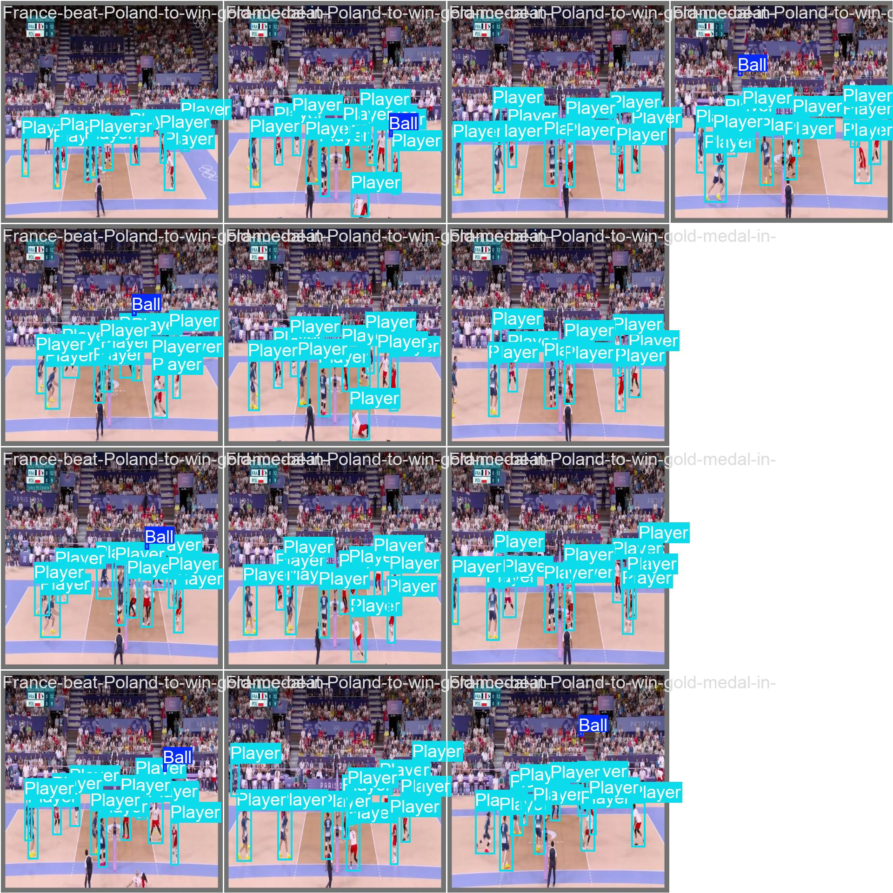
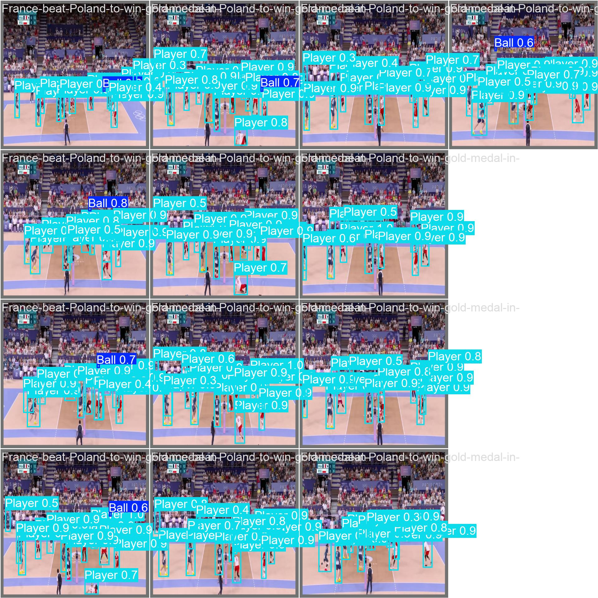

# Reconocimiento de objetos en voleibol con YOLO

Detección de **jugadores** y **balón** en partidos de voleibol con modelos YOLO de Ultralytics.
El proyecto compara las variantes **YOLOv8n (Nano)** y **YOLOv8s (Small)** y conserva los pesos
entrenados para replicar los resultados originales.

> Actualizado en noviembre de 2026: scripts con CLI, dependencias actualizadas y rutas portátiles.
> El experimento original (diciembre de 2024) se describe más abajo.

## 📁 Estructura

```
.
├── README.md
├── requirements.txt
├── data/
│   └── data.yaml.example   # plantilla del dataset (el YAML real no está en el repo)
├── src/
│   ├── common.py           # dispositivo automático, colores y dibujo de cajas
│   ├── train.py            # entrenamiento
│   ├── predict_image.py    # inferencia en imágenes
│   └── predict_video.py    # inferencia en vídeos o webcam
├── models/                 # pesos YOLOv8n-100e.pt y YOLOv8s-50e.pt
└── assets/                 # imágenes etiquetada y predicha del experimento original
```

## ⚙️ Instalación

Requiere Python 3.10 o superior (probado con 3.12).

```bash
python -m venv .venv
# Windows PowerShell: .venv\Scripts\Activate.ps1
# macOS/Linux:        source .venv/bin/activate
pip install -r requirements.txt
```

Para aceleración GPU instala PyTorch con el build correspondiente antes de los comandos anteriores:
<https://pytorch.org/get-started/locally/>. En Apple Silicon se usa automáticamente `mps`.

## 📊 Dataset

El dataset se creó a partir de vídeos de YouTube y se etiquetó con Roboflow:
<https://universe.roboflow.com/antonyma/volleyball-video/dataset/2> (439 imágenes tras
post-procesamiento, clases `Ball` y `Player`).

Las imágenes y el `data.yaml` original **no están incluidos** en el repositorio. Para entrenar:

```powershell
Copy-Item data/data.yaml.example data/data.yaml   # PowerShell
# cp data/data.yaml.example data/data.yaml        # macOS/Linux
```

Después edita `data/data.yaml` con la ruta real de tus imágenes y verifica el orden de las clases.

## 🚀 Entrenamiento

```bash
# Modelo usado en el experimento original (YOLOv8s, 50 épocas)
python src/train.py --data data/data.yaml --epochs 50

# Alternativa con la familia más reciente de Ultralytics (requiere reentrenar)
python src/train.py --data data/data.yaml --model yolo26s.pt --epochs 50
```

Opciones útiles: `--model` (nombre oficial o ruta `.pt`), `--imgsz` (640 por defecto),
`--device` (`auto`, `cpu`, `mps`, `cuda`, índice de GPU) y `--name` (carpeta del run).
Con `auto` se elige CUDA, luego MPS y finalmente CPU. Los resultados se guardan en `runs/detect/`.

## 🔍 Inferencia

```bash
# Una imagen
python src/predict_image.py --source assets/labeled.jpg --output assets/predicted_new.jpg

# Un vídeo (salida por defecto: <entrada>_detected.mp4)
python src/predict_video.py --source "ruta/al/partido.mp4" --output "ruta/al/partido_detected.mp4"

# Webcam, mostrando el vídeo en vivo (salir con 'q')
python src/predict_video.py --source 0 --show
```

Por defecto se usan los pesos `models/YOLOv8s-50e.pt` y un umbral de confianza de `0.5`
(`--conf`). Los jugadores se dibujan en azul y el balón en verde. Cambia el modelo con
`--model models/YOLOv8n-100e.pt` o con la ruta a un run propio.

## 📈 Resultados del experimento original (diciembre 2024)

Entrenamiento a 640×640 en Apple M2 con Ultralytics 8.3.40 y Torch 2.5.1:

| Modelo | Épocas | mAP@0.5 global |Conclusión |
| :--- | :--- | :--- | :--- |
| **YOLOv8n** | 100 | 11,1 % | Eficiente, pero con baja precisión en el balón. |
| **YOLOv8s** | 50 | 91,0 % | Mejor equilibrio y robustez; modelo recomendado. |

YOLOv8s alcanzó **98,9 % de mAP** para `Player` y **88,3 %** para `Ball`. El modelo Nano
tuvo dificultades para generalizar y detectar objetos pequeños como el balón.

> Nota: las cifras de FPS del README anterior (0,54 y 1,36) se han retirado porque no se
> documentó el protocolo de medición y no son comparables. Los valores de mAP se mantienen
> tal como se publicaron originalmente; no han sido recalculados con la versión nueva.

| Etiquetado original (Roboflow) | Predicción del modelo |
| :---: | :---: |
|  |  |

## 💡 Conclusión

Los modelos ligeros son rápidos, pero necesitan datasets más grandes y diversos para tareas
de alta precisión. Para este caso de uso se recomienda YOLOv8s. Las familias más recientes
(por ejemplo YOLO26s) están disponibles como opción, pero sus pesos COCO no están validados
en este dataset y requieren reentrenamiento antes de comparar métricas.

---

* Autor: Antonio Jesús Angulo Magdaleno
* Experimentos originales: diciembre 2024 · Actualización del repositorio: noviembre 2026
